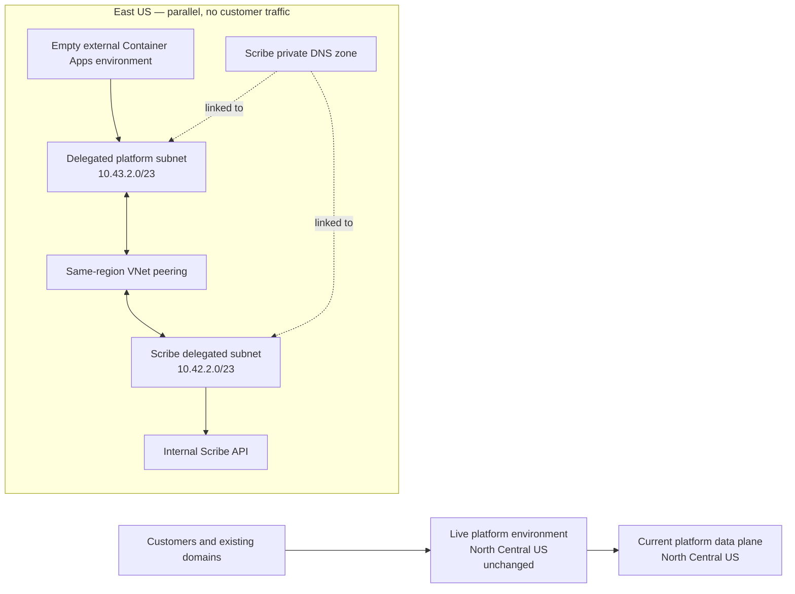

# Parallel platform and private Scribe network plan

**Plan date:** 2026-08-13  
**Approval state:** design approved; deployment and cutover not approved

## Outcome

Build a second platform Container Apps environment beside the live one, connect its VNet privately
to Scribe, and leave the existing production environment authoritative until separate foundation,
workload, and traffic reviews pass. All Terraform switches remain `false` by default.

This plan does not remove Clerk, replace patient identity, expose Scribe, deploy an application,
bind `app.cosmaneura.com` or `chat.cosmaneura.com`, change public/private DNS, migrate data, enable a
feature flag, or send customer traffic.

## Read-only inventory

| Boundary | Current state | Design implication |
| --- | --- | --- |
| Platform runtime | North Central US, public Container Apps environment, no VNet integration | Its network type cannot be changed; create a parallel environment |
| Platform data plane | PostgreSQL, Redis, ACR, uploads, transcripts, and Log Analytics in North Central US | East US workload cloning requires a separate data-path review |
| Scribe runtime | East US, internal Container Apps environment at `10.42.2.62` | Keep private and resolve through its private DNS zone |
| Scribe network | `10.42.0.0/16`; no current peerings | Use non-overlapping `10.43.0.0/16` for the platform |
| Scribe DNS | wildcard record in `yellowstone-7e7a33ab.eastus.azurecontainerapps.io`, linked only to the Scribe VNet | Link the existing zone to the platform VNet from Scribe's state |
| Scribe lifecycle | deployed environment is development | Synthetic tests only; no production customer traffic |

The subscription-wide VNet inventory also contains `10.0.0.0/16` networks in West US and West US
2. No existing VNet uses or overlaps `10.43.0.0/16` as of the plan date. Recheck immediately before
an apply because VNet address spaces are shared subscription state.

## Target topology



The platform environment is external because it is the eventual browser/API entry point. Its VNet
integration controls outbound routing to Scribe; it does not make the platform ingress private.
Scribe remains internal with public network access disabled.

## Terraform ownership and expected resources

The platform plan owns five resources:

1. `azurerm_virtual_network.parallel_platform` — East US, `10.43.0.0/16`.
2. `azurerm_subnet.parallel_container_apps` — dedicated `/23`, delegated only to
   `Microsoft.App/environments`.
3. `azurerm_log_analytics_workspace.parallel_platform` — separate East US logs, 30-day retention,
   0.5 GiB daily cap.
4. `azurerm_container_app_environment.parallel_platform` — external workload-profile environment,
   no applications.
5. `azurerm_virtual_network_peering.parallel_platform_to_scribe` — platform-owned side only.

The Scribe plan owns two resources:

1. `azurerm_virtual_network_peering.scribe_to_parallel_platform` — Scribe-owned reverse side.
2. `azurerm_private_dns_zone_virtual_network_link.parallel_platform_container_apps` — links the
   existing Scribe Container Apps private zone to the platform VNet with registration disabled.

No state file reads another state file. The plans exchange only Azure resource IDs, which are not
credentials.

## Design verification result

On 2026-08-13, OpenTofu 1.12.5 formatting and validation passed in both repositories. Read-only,
targeted, no-refresh plans against the existing states produced:

| State owner | Result | Scope |
| --- | --- | --- |
| Platform | **5 to add, 0 to change, 0 to destroy** | VNet, subnet, Log Analytics, empty Container Apps environment, outbound peering |
| Scribe | **2 to add, 0 to change, 0 to destroy** | reverse peering, existing private-zone VNet link |

These targeted plans validate the conditional resource graph; they are deliberately not saved and
are not deployment artifacts. Resource targeting and disabled refresh mean they cannot establish
the absence of unrelated drift. Each future gate therefore requires a fresh, full, refreshed plan
against live state, saved and approved immediately before its apply.

## Review and execution gates

### Gate 0 — current approved work

- Keep both repository flags `false`.
- Run formatting, validation, and false-by-default plans.
- Generate but do not apply a full enabled platform plan. Acceptance: exactly the intended
  foundation additions, with no unexpected changes and no destroys.
- Review resource names, regions, CIDRs, managed infrastructure, current quotas, and cost-bearing
  meters.
- Confirm each deployment identity has only the cross-VNet actions needed to peer its local VNet
  and read/join the remote VNet. The Scribe identity also needs write access to its own private DNS
  zone and read/join access to the platform VNet for the link. Do not create credentials or grant
  subscription Owner merely to satisfy these plans.

### Gate 1 — foundation deployment (not approved)

After explicit approval, enable the platform flag only for the reviewed apply:

```hcl
deploy_parallel_vnet_environment = true
scribe_virtual_network_id        = "/subscriptions/<subscription>/resourceGroups/cosmaneura-scribe-development/providers/Microsoft.Network/virtualNetworks/cosmaneura-scribe-development-vnet"
```

Apply the exact saved platform plan. Confirm the live environment and all four live Container Apps
are unchanged. Capture the `parallel_platform_virtual_network_id` output.

### Gate 2 — reverse peering and private DNS (not approved)

Supply that output to the Scribe plan:

```hcl
connect_parallel_platform_vnet = true
parallel_platform_vnet_id      = "/subscriptions/<subscription>/resourceGroups/cosmaneura-prod/providers/Microsoft.Network/virtualNetworks/cosmaneura-prod-parallel-vnet"
```

Apply only after the Scribe plan shows two additions, zero changes, and zero destroys. Confirm both
peerings report `Connected` and the existing Scribe wildcard still resolves to `10.42.2.62` from
the platform VNet.

### Gate 3 — synthetic workload validation (not designed or approved here)

Define a separate, scale-to-zero test caller in the parallel environment. Do not clone production
settings wholesale. With synthetic identifiers only, prove:

- the Scribe FQDN resolves to its private IP;
- an unauthenticated workflow call returns `401`;
- a valid token without the required role or caller identity returns `403`;
- the exact managed identity and role can complete one idempotent consent/session flow; and
- logs contain no tokens, identity claims, patient data, transcript text, or signed URLs.

### Gate 4 — production workload and data-path design (not approved)

Before any production clone, decide whether the platform data plane also moves to East US or stays
in North Central US behind approved private connectivity. Review latency, failover, backup,
residency, firewall rules, ACR access, Redis, PostgreSQL, storage, migration jobs, worker/scheduler
behavior, and Log Analytics. Create a production Scribe boundary; the development Scribe
environment is never a customer-traffic destination.

### Gate 5 — traffic cutover (not approved)

Only after functional, security, performance, and rollback tests pass may a separate plan attach
custom domains/certificates and move a bounded traffic slice. Keep the old environment intact and
feature flags off until that review explicitly approves them.

## Rollback boundaries

- Before Gate 3, rollback is a reviewed Terraform destroy of only the seven new foundation/link
  resources; no customer runtime depends on them.
- During synthetic tests, disable/delete the test caller first, then remove the DNS link, reverse
  peering, platform peering, and platform foundation through their owning states.
- After any future customer cutover, move traffic and Scribe flags back to the old environment
  first. Do not destroy either environment until the observation window and data reconciliation
  are complete.

## Incremental cost surfaces

- VNet and subnet definitions have no fixed hourly compute charge.
- A VNet-injected external Container Apps environment can incur Azure-managed infrastructure
  charges, including its standard load balancer, public IP, and management data processing, even
  before application compute is deployed.
- Same-region peering is billed for data transferred in each direction.
- The separate Log Analytics workspace is billed by ingestion and retention; the design caps daily
  ingestion at 0.5 GiB.
- The existing private DNS zone remains; DNS queries are usage-based.
- There is no application replica charge in this foundation because it contains no Container App.

Recheck the Azure retail meters and the enabled OpenTofu plan on the day deployment approval is
requested.
